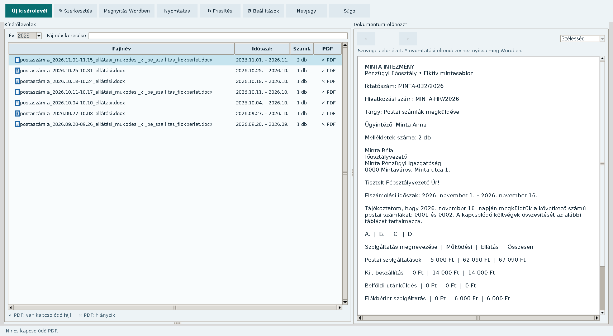
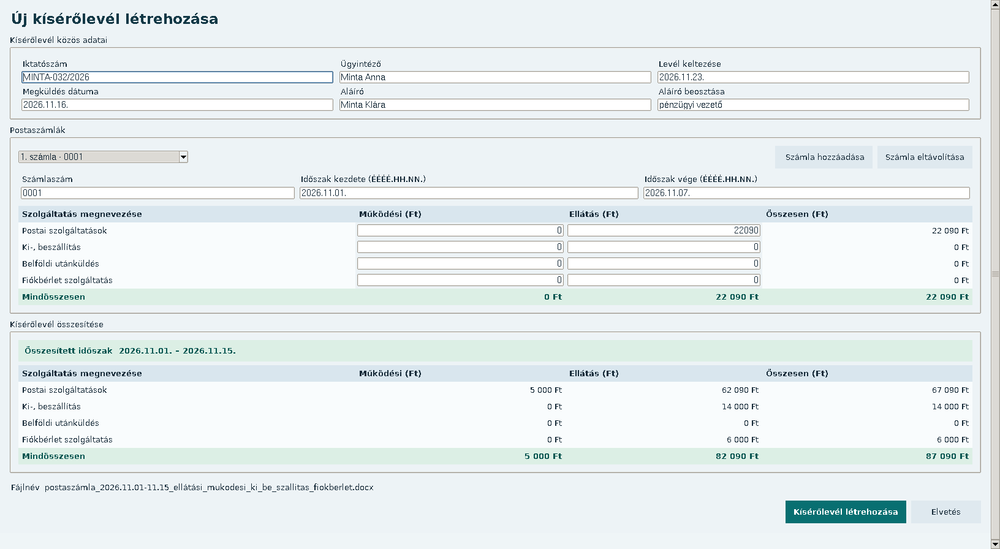
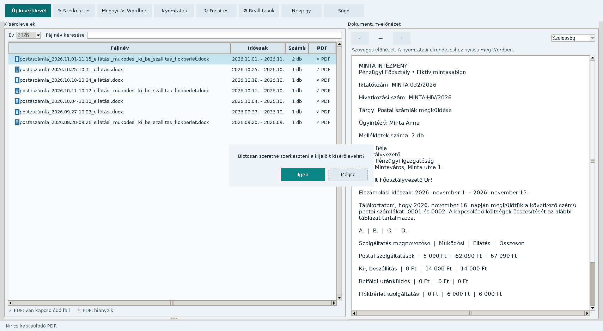

# Postaszámla – Kísérőlevelek v0.3.0

A v0.3.0 Tkinter asztali felületet ad a korábbi dokumentumgeneráló motorhoz. A ZIP a telepíthető Python-forrásprojektet és a fiktív mintasablont tartalmazza. A futtatás lépéseit a [használati útmutató](https://github.com/baloghim/postaszamla_kiserolevel/blob/v0.3.0/README.md#asztali-alkalmazás) mutatja.

## Dokumentumtár és előnézet

Az éves lista fájlnév szerint kereshető, oszloponként rendezhető, és jelzi a kapcsolódó PDF meglétét. A kijelölt dokumentum adatai a lista alatt, előnézete a jobb oldali panelen jelenik meg.

## Több számla egy kísérőlevélben

Minden számla önálló elszámolási időszakot és négy szolgáltatási sort kap. A levélhez tartozó összegek, az időszak és a fájlnév a rögzített tételekből frissülnek.

## Megerősített szerkesztés és hordozható beállítások

A szerkesztéshez és a mentéshez külön jóváhagyás szükséges. A program megőrzi a számlánkénti adatokat, szerkesztés előtt pedig ellenőrzött biztonsági másolatot készít. A beállítások a programkönyvtárban található `beallitasok.json` fájlba kerülnek.

A képek a futó alkalmazásról készültek, fiktív adatokkal, Linuxon. Az előnézeti panel ezért a szöveges módot mutatja. Mind a 28 automatizált teszt sikeres. A Word 2016 COM-konverziója, a nyomtatás és a DPI-skálázás Windows 10 1607 alatt célgépes próbát igényel.
