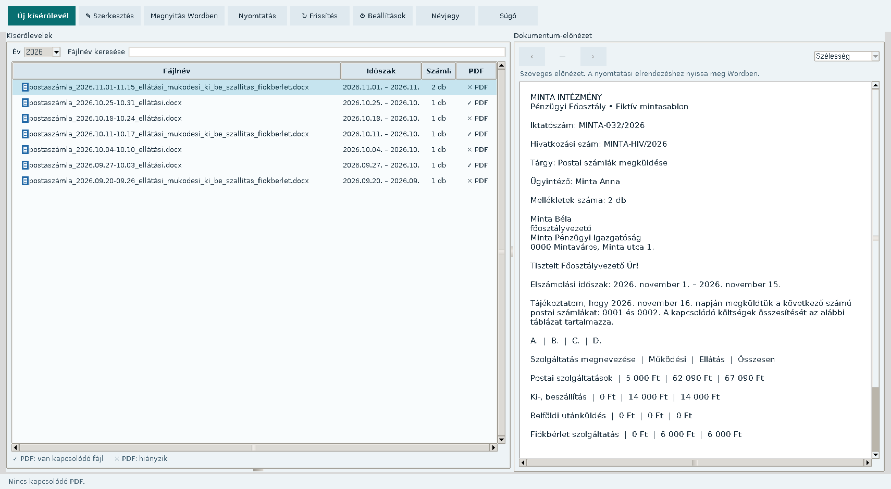
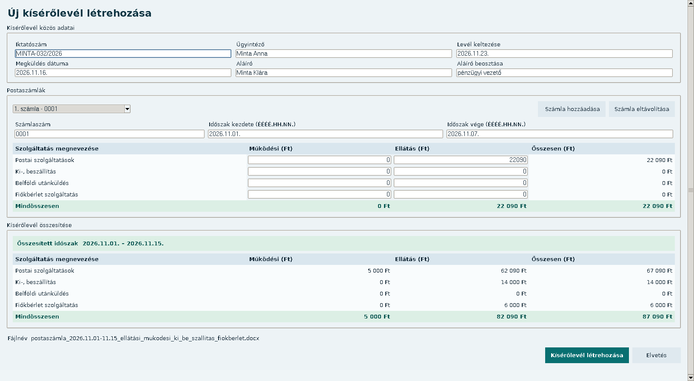
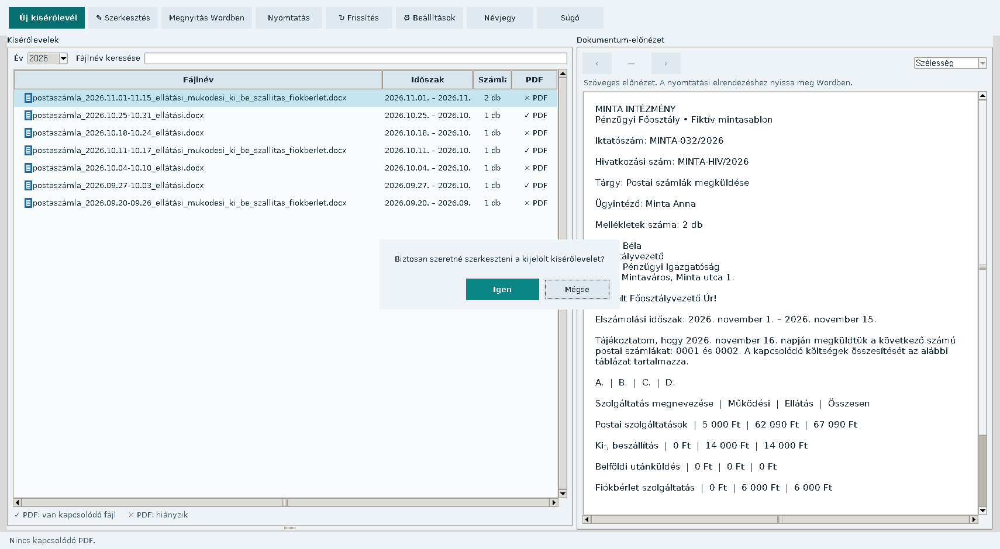

# Postaszámla – Kísérőlevelek v0.3.4

## Hordozható Windows-alkalmazás

Töltsd le a `Postaszamla-v0.3.4-win64.zip` csomagot a kiadás letölthető fájljai közül. Csomagold ki egy írható mappába, majd indítsd el a `Postaszamla\Postaszamla.exe` fájlt. A mellette lévő `_internal` mappát tartsd meg. A csomag tartalmazza a Python-futtatókörnyezetet és a fiktív mintasablont. Az EXE az első indításkor hozza létre mellette a `beallitasok.json` fájlt.

## Mi változott?

- A verziócímke Windows runneren indítja a PyInstaller x64 `onedir` buildet. A kicsomagolt EXE indítási próbája a felületet, a beállításfájlt, a DOCX-generálást, a PDF-előnézetet és a Word COM-modul betöltését ellenőrzi.
- A beépített PDF-előnézet PDFiumot használ. A Word nyomtatási elrendezését továbbra is a helyben telepített Microsoft Word állítja elő.
- A kiadás külön letöltésként tartalmazza a forráskód ZIP-jét és a Windows alkalmazás ZIP-jét.

## Ismert korlátozások

A futtatás célrendszere a 64 bites Windows 10 1607. A csomagolás és az indítási próba Windows Server 2022 GitHub runneren fut. A Windows 10 1607 alatti működés és a Word 2016 tényleges COM-konverziója, valamint a nyomtatás még célgépes ellenőrzést igényel. Word nélkül a program szöveges dokumentum-előnézetet kínál. A képernyőképek a futó asztali alkalmazást mutatják Linuxon, fiktív adatokkal.
