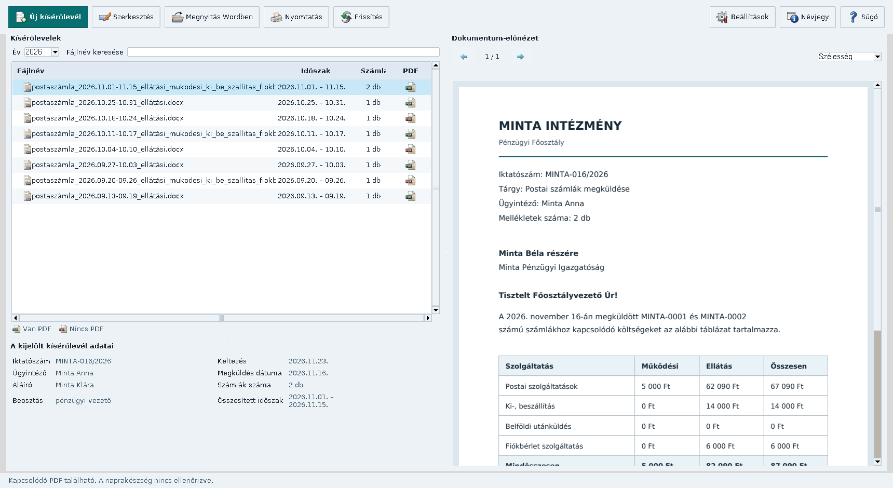
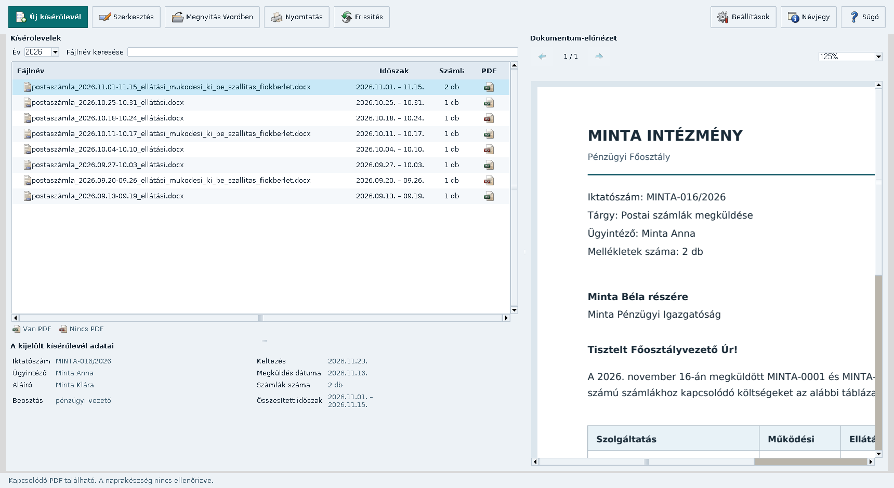

# Postaszámla – Kísérőlevelek v0.3.5

## Főablak

- Világos, Fusion-jellegű megjelenés a meglévő Tkinter/ttk felületen.
- Helyben csomagolt KDE Modern Classic ikonok az eszköztáron, a DOCX-soroknál, a PDF-jelzéseknél és a lapozásnál. Az eszköztár gombjai súgószöveget kaptak. A Beállítások, Névjegy és Súgó a jobb oldali csoportba került.
- Új vagy alaphelyzetbe állított konfigurációnál a két panel egyenlő szélességű. A kézzel beállított elválasztóhely a hordozható konfigurációban megmarad.

## Dokumentum-előnézet

A „Szélesség” mód automatikusan követi az előnézet méretét, lapozáskor is. A vízszintes görgetősáv nagyításkor jelenik meg, ha a lap szélesebb a nézetnél. A függőleges görgetés továbbra is használható.

## Ellenőrzés és korlátozások

A képek a futó alkalmazásról készültek Linuxon. Az alkalmazás a fiktív PDF-et a beépített PDFium-nézetben jeleníti meg. A Windows-csomag tartalmazza az ikonokat, az SVG-forrásokat és a licencszövegeket. [KDE Modern Classic és a licenc](https://github.com/nzoomed/kde-modern-classic/tree/466f093bf391f80c67cef60a24d4013be2536707)

A program Tkinter/ttk témát használ. A natív Qt Fusion más grafikus keretrendszerhez tartozik. A Windows 10 1607 és a Word 2016 együttműködése, valamint a célgépes DPI-ellenőrzés még helyi próbát igényel.
