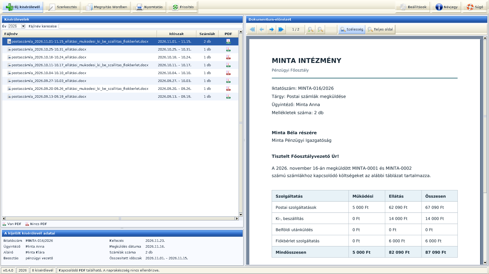
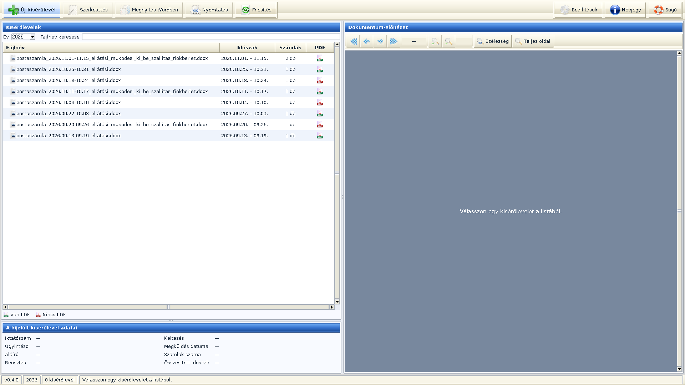

# Postaszámla – Kísérőlevelek v0.4.0

A főablak az EDPD Menedzser 2.6.3 XP Luna Blue megjelenéséhez igazodik. A három panel kék színátmenetes címsávot, a műveletek krémszínű, térhatású gombokat kaptak. A kijelölt dokumentum sötétebb kék háttérrel emelkedik ki a váltakozó fehér és halványkék sorokból. Az állapotsor külön mezőben mutatja a verziót, az évet, a listázott levelek számát és az aktuális visszajelzést.

A betekintőn külön gomb jut az első, előző, következő és utolsó oldalnak, a nagyításnak és kicsinyítésnek, valamint a szélességre és teljes oldalra igazításnak. A kékesszürke munkaterületen jól elkülönül a fehér lap. Üres előnézetnél a munkaterület közepén jelenik meg az útmutató. A vízszintes görgetősáv csak túlméretes lapnál jelenik meg.

Az ikonok az EDPD által is használt Crystal Remix készlet rögzített változatából származnak. Az eredeti PNG-k és a GNU LGPL licencanyagok a Windows-csomagban is megtalálhatók. [EDPD 2.6.3 ikonforrások](https://github.com/baloghim/beerkezett_posta_kezeles/blob/v2.6.3/docs/ICONS.md) · [Crystal Remix forrás](https://github.com/dangvd/crystal-remix-icon-theme/tree/f8863b558b8eedf22caea0eabe18030bfcbe0783)

A képek a futó Tkinter alkalmazásról készültek 1920 × 1080-as linuxos virtuális kijelzőn, fiktív adatokkal. A kijelölt levél nézetét a beépített PDFium egy fiktív PDF-ből jeleníti meg. A Windows 10 1607 és a Word 2016 célgépes próbája továbbra is szükséges.
