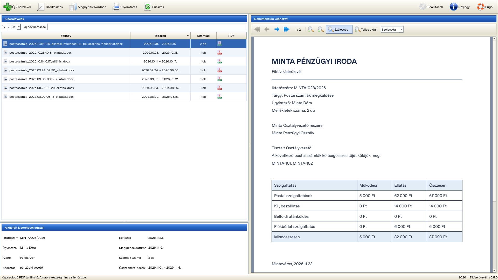
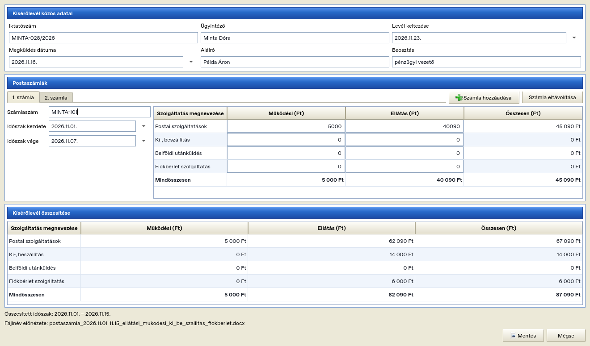

# Postaszámla – Kísérőlevelek v0.5.0

## Újdonságok

- Az alkalmazás indításakor PySide2 és Qt 5 alapú felület nyílik meg. A főablak, az új levél és a szerkesztés ugyanazt az XP Luna Blue stílust használja.
- A főablak a beállított dokumentumtárat jeleníti meg. A levelek év és fájlnév szerint kereshetők, előnézetben megtekinthetők, Windowson Wordben megnyithatók és nyomtathatók. Az ablak két oldala alapértelmezésben azonos szélességű.
- A levélszerkesztő a számlánkénti költségekből a meglévő számítási szabályokkal frissíti az összegeket, az elszámolási időszakot és a fájlnevet. A DOCX, a kapcsolódó adatfájl és a szerkesztéskori biztonsági másolat formátuma változatlan.
- A meglévő `beallitasok.json` átvihető az új EXE mellé. Tiszta indításkor a program ugyanitt hozza létre a fájlt. A csomag saját Python 3.10.11 x64 futtatókörnyezetet tartalmaz.
- A korábbi Tkinter-felület letölthető a [legacy/tkinter ágról](https://github.com/baloghim/postaszamla_kiserolevel/tree/legacy/tkinter). A JSON-ból DOCX-et készítő parancssori mód továbbra is használható.

## Képernyőképek

A futó Qt-alkalmazást 1920 × 1080-as Linux virtuális asztalon örökítettük meg fiktív számlákkal. A főablakban fiktív kétoldalas PDF látható.

## Ismert korlátozások

- A Windows-csomag a Windows 10 1607 x64 célplatformhoz választott Qt 5-függőségeket használja. A csomagolt EXE ellenőrzése Windows Server 2022 környezetben fut. A Windows 10 1607 célgépen az indítás, a Word 2016 PDF-konverzió és a nyomtatás még ellenőrzendő.
- A Word-alapú előnézethez Windows és Microsoft Word szükséges. Ha a Word nem érhető el, az olvasható dokumentumokból szöveges előnézet jelenik meg. A Wordben megnyitáshoz és nyomtatáshoz DOCX-fájltársítás szükséges.
- A csomag az XP Luna Blue stílus Postaszámlához igazított változatát és a licencelt Crystal Remix ikonokat tartalmazza. Az eredeti EDPD-téma betöltéséhez a saját, helyi EDPD 2.6.3 munkapéldány útvonalát a `--edpd-source` kapcsolóval lehet megadni.
