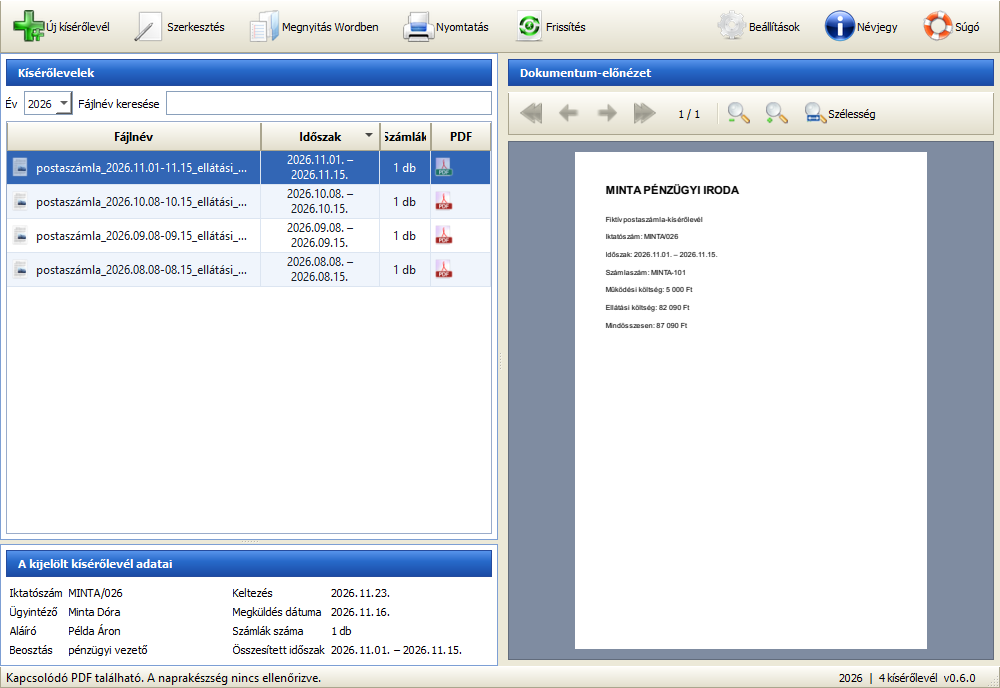
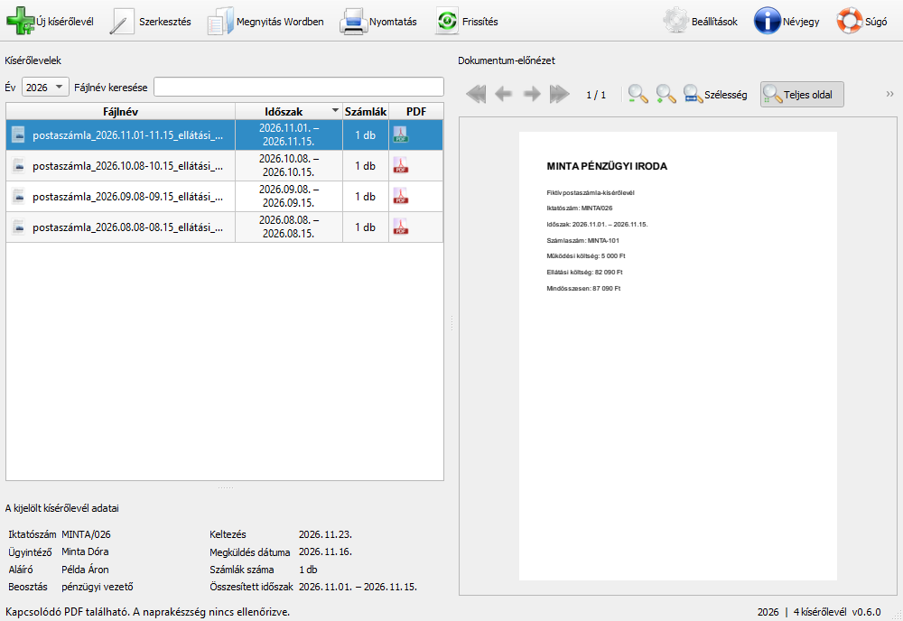
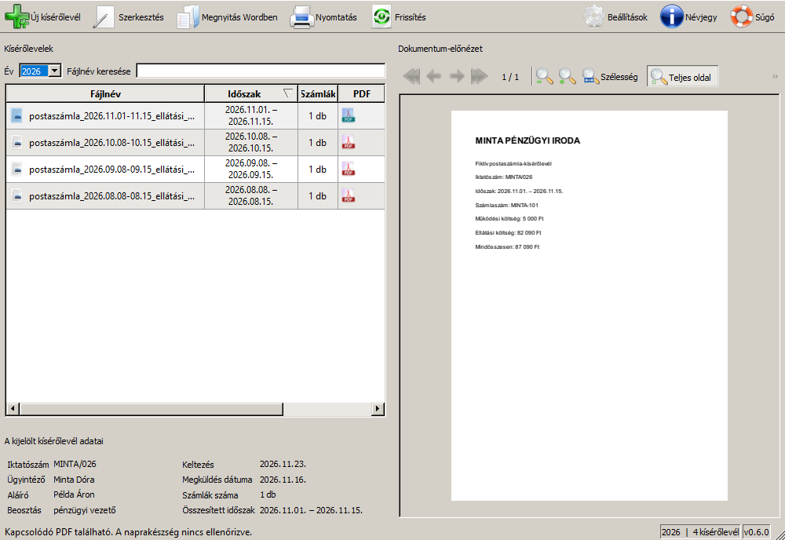
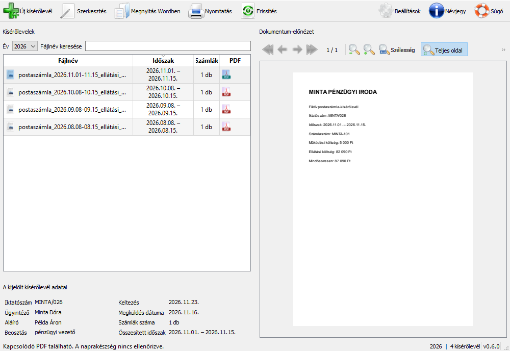
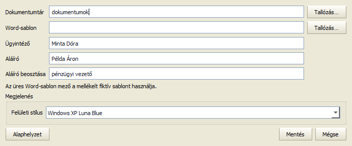

# Postaszámla – Kísérőlevelek v0.6.0

A **Beállítások → Megjelenés → Felületi stílus** listában választható a Windows XP Luna Blue és az adott rendszeren elérhető gyári Qt-stílusok. Az alkalmazás felületén a választás a **Mentés** után rögtön érvényesül. A **Mégse** megőrzi az aktív stílust és a beállításfájlt.

A stílus a hordozható `beallitasok.json` fájl `ui_style` mezőjébe kerül. Hiányzó mezőnél, új beállításfájlnál vagy a mentett stílus elérhetetlensége esetén a program XP Luna Blue megjelenéssel indul. A váltás közben a megnyitott dokumentum előnézete megmarad.

## Képernyőképek

A képek a futó Qt 5 alkalmazásról készültek Windows Server 2022 alatt, fiktív adatokkal. Mind a négy főablak képe 1000 × 688 képpontos.

### Windows XP Luna Blue

### Fusion

### Windows

### Windows Vista

### Stílusválasztó

## Kompatibilitás

A Windows x64 csomag tartalmazza a Qt 5 Vista-stílusplugint. A GitHub Actions a kicsomagolt EXE-ben ellenőrzi mindhárom gyári stílus betöltését. A Windows 10 1607 célrendszeren a Vista-stílus elérhetősége és megjelenése még célgépes ellenőrzést igényel.
