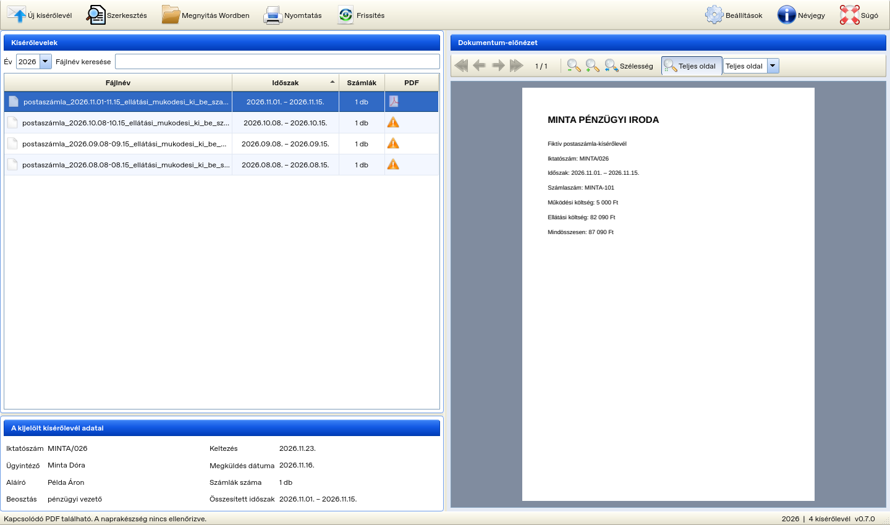
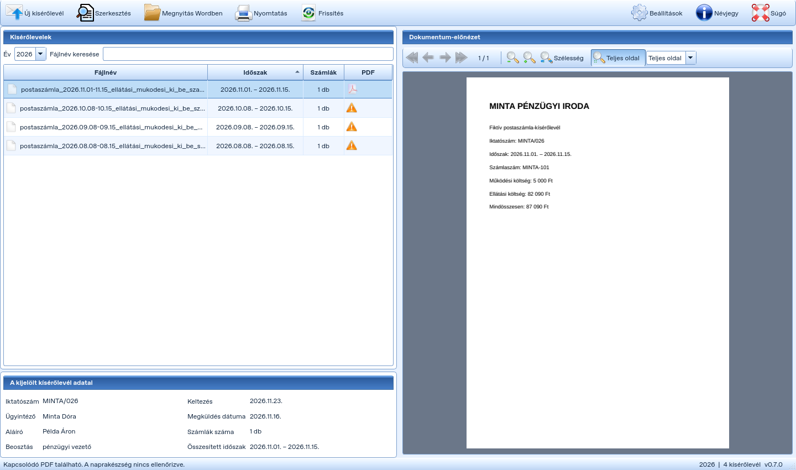
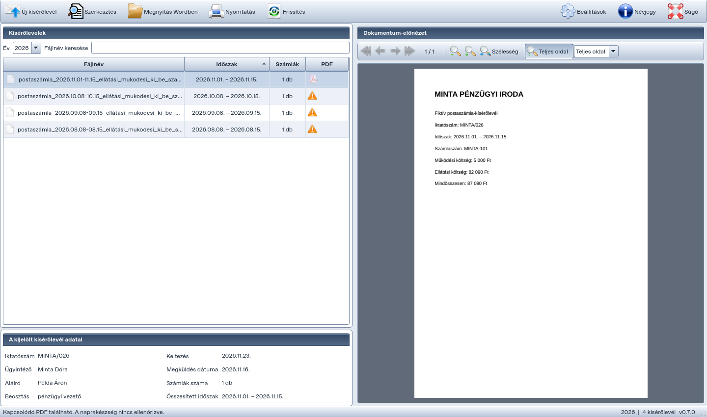
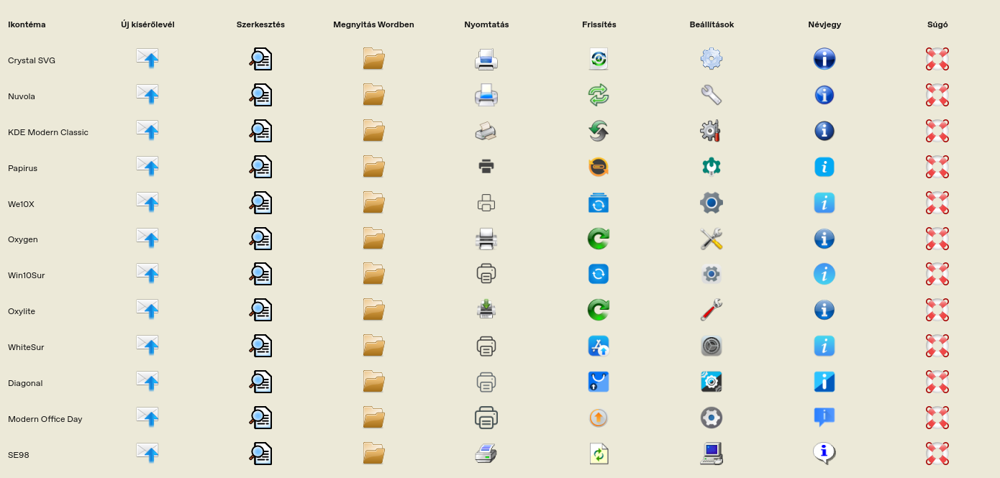

# Postaszámla – Kísérőlevelek v0.7.0

A Postaszámla tartalmazza az EDPD Menedzser 2.6.3 három egyedi felületét és mind a tizenkét ikontémáját. A **Beállítások → Megjelenés** részen a felületi stílus és az ikontéma külön választható. Az alapbeállítás a Windows XP Luna Blue és a Crystal SVG. A **Mentés** azonnal alkalmazza a választást, és a hordozható `beallitasok.json` fájlba írja. A meglévő dokumentumkijelölés és előnézet megmarad.

A Qt gyári Fusion, Windows és Windows Vista stílusa ott jelenik meg a listában, ahol a Qt betölti. Az eredeti grafikai fájlok, a licencek és a szerepenkénti helyettesítések a csomag részei. [Eredet, licencek és ikon-hozzárendelések](https://github.com/baloghim/postaszamla_kiserolevel/blob/v0.7.0/docs/edpd-grafika.md)

## Képernyőképek

A képek a futó PySide2/Qt 5 alkalmazásból készültek Linuxon, fiktív adatokkal. Mindhárom főablakképen a Crystal SVG ikontéma látható, azonos, 1440 × 850 képpontos ablakban.

### Windows XP Luna Blue

### Longhorn Blue

### Longhorn Slate

### A Postaszámla eszköztári ikonjai

## Indulás és Windows-csomag

Az első Qt-eseményciklusig mért medián hét friss indítás alapján 3,294 másodperc volt. Azonos Linux-környezetben a v0.6.0 mediánja 3,281 másodperc volt. Az ikonok betöltése igény szerint történik.

A csomag Python 3.10.11 x64, PySide2 és shiboken2 5.15.2.1, valamint Qt 5.15.2 használatával készül. A PyMuPDF 1.23.26 és PyMuPDFb 1.23.22 a fejlesztői kompatibilitási ellenőrzés része. A Postaszámla dokumentumbetekintője a meglévő PDFium-motort használja. A Windows 10 1607 célgépes futtatása külön ellenőrzést igényel.
