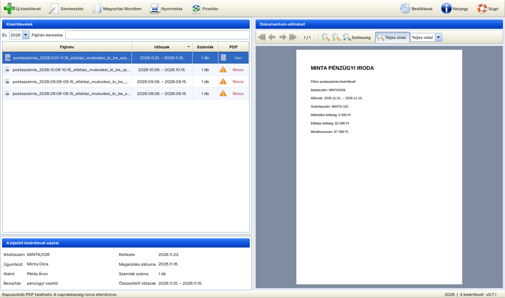
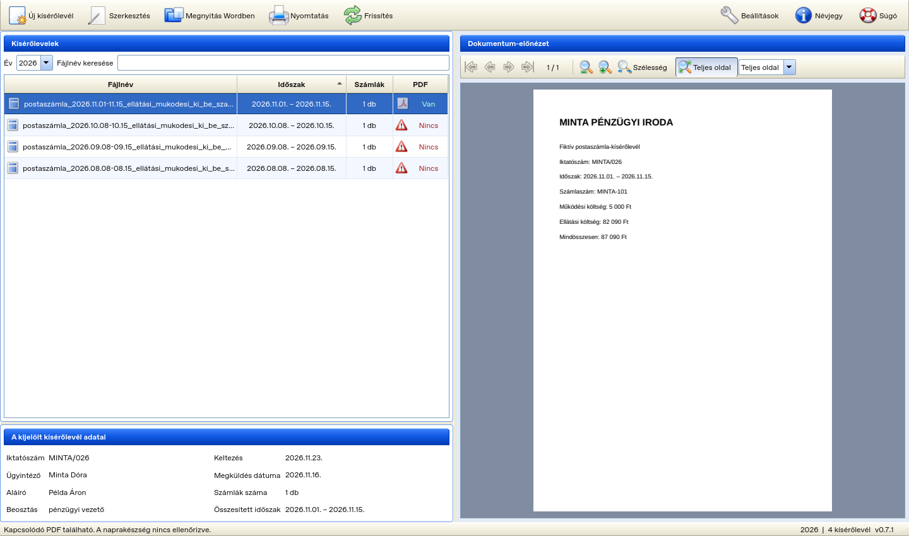
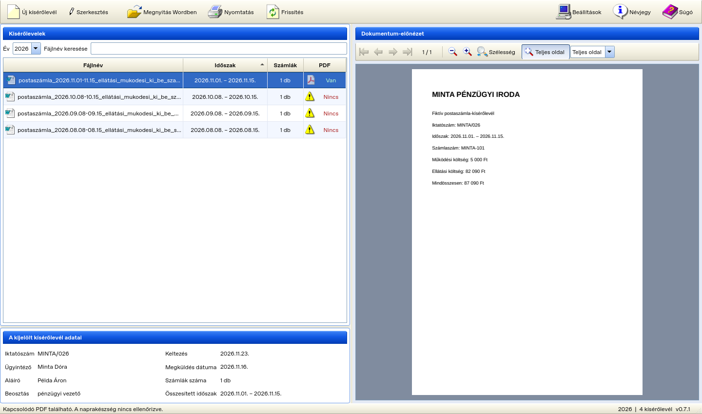

# Postaszámla – Kísérőlevelek v0.7.1

A kiválasztott ikontéma azonnal frissíti a főablak, a dokumentumlista, a betekintő eszköztára, a szerkesztő, a beállítások és a megnyitott párbeszédablakok ikonjait. A mezők és a szöveges betekintő helyi menüi is a központi ikonkezelőt használják. A PDF-sorokban a zöld **Van** és a piros **Nincs** jelzés a témától függetlenül olvasható.

A hiányzó szerepekhez a témák rögzített forrásverzióiból kerültek be ikonok. Mind a tizenkét készletben saját ikonja van az Új kísérőlevél, a Megnyitás Wordben és a Súgó műveletnek. Az eredet és a fennmaradó helyettesítések a leltárban ellenőrizhetők. [Ikonleltár](https://github.com/baloghim/postaszamla_kiserolevel/blob/v0.7.1/docs/icon-audit.md) · [Gépi forrásjelentés](https://github.com/baloghim/postaszamla_kiserolevel/blob/v0.7.1/docs/icon-sources.json)

Az alkalmazás címsora és az EXE egy rögzített ikont használ. A kiválasztott Ravenna Mail forrása és licence jelenleg hozzáférésre vár. A v0.7.1-ben a rögzített grafika a meglévő Crystal Remix DOCX-ikon.

## Képernyőképek

A képek a futó Qt 5 alkalmazásról készültek Linuxon, azonos 1440 × 850 képpontos ablakban, XP Luna Blue felülettel és fiktív dokumentumokkal.

## Windows-ellenőrzés

A csomag ellenőrzi mind a 12 ikontéma 34 szerepét, a rögzített alkalmazásikont, az eredeti erőforrásokat és a licencanyagokat. A Windows-csomag futtatási ellenőrzése Windows Server 2022-n történik. A Windows 10 1607 célgépes próba külön ellenőrzést igényel.
