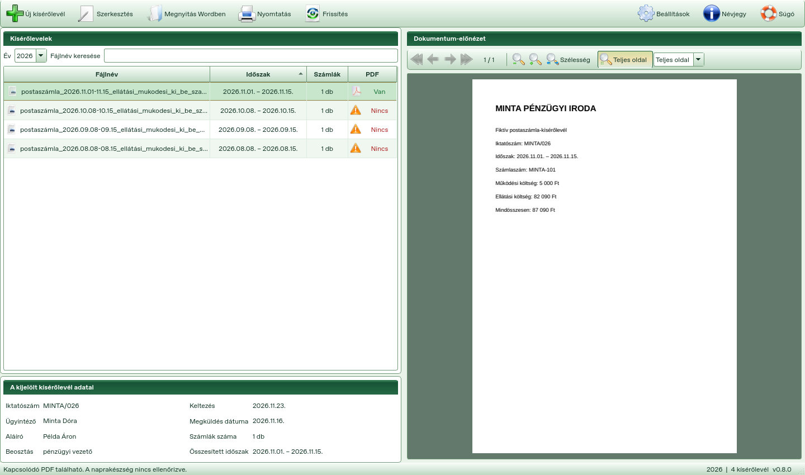
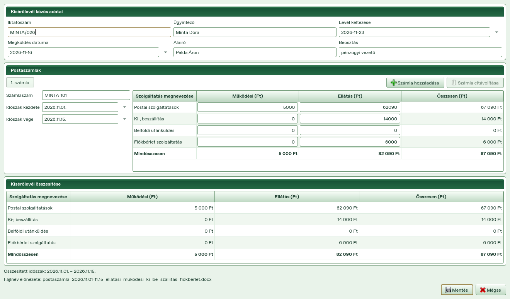

# Postaszámla – Kísérőlevelek v0.8.0

A **Postás zöld** a **Beállítások → Megjelenés → Felületi stílus** listában választható. A Longhorn színátmeneteit, formáit és méreteit közös stíluslap adja. Az új paletta világos zöld felületeket, mélyzöld panelcímeket és visszafogott arany kiemeléseket használ. A **Mentés** azonnal alkalmazza a témát, és a választást a hordozható `beallitasok.json` fájl `ui_style` mezőjébe írja.

A Longhorn Blue, Longhorn Slate és XP Luna Blue generált stíluslapja bájtpontosan egyezik a v0.7.1 változattal. A PDF-oldal eredeti színét a betekintő megőrzi témaváltáskor.

## Képernyőképek

A képek a futó PySide2/Qt 5 alkalmazásról készültek Linuxon, fiktív dokumentummal és számlaadatokkal.

## Alkalmazásikon

A főablak, a párbeszédablakok, a Névjegy és a Windows EXE ugyanazt a rögzített többméretű ICO-t használja. A v0.8.0 ezt a korábban csomagolt, Crystal Remix eredetű DOCX-grafikával adja ki.

A kért Double-J Design Ravenna 3D Mail ikon átvétele függőben van. Az IconArchive oldalát és kép-CDN-jét az ellenőrző környezet 403-as válasszal elutasította, így a grafikát és a terjesztési feltételeit innen továbbra sem lehetett ellenőrizni. [A kért Ravenna Mail ikon](https://www.iconarchive.com/show/ravenna-3d-icons-by-double-j-design/Mail-icon.html) · [A csomagolt ikon forrása és licence](https://github.com/baloghim/postaszamla_kiserolevel/blob/v0.8.0/postaszamla/qt/edpd_graphics/assets/notices/APPLICATION-ICON.md)

## Windows

A csomag továbbra is a rögzített Python 3.10.11 x64 és Qt 5.15.2 verziókra épül. A GitHub Actions ellenőrzi az EXE-be ágyazott ICO-t és a natív ablakikont Windows Server 2022-n. A Windows 10 1607 célgépes próba külön ellenőrzést igényel.
