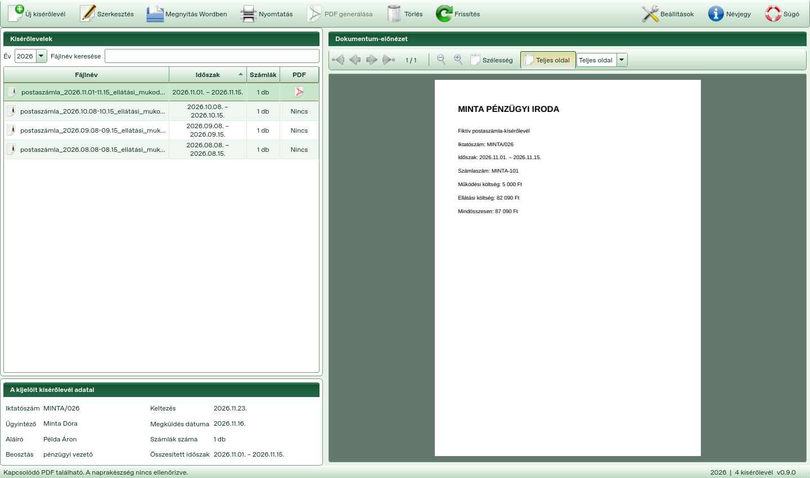
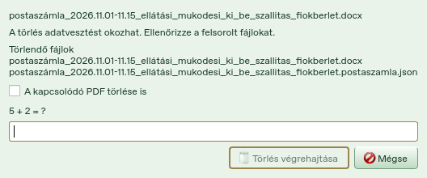

# Postaszámla – Kísérőlevelek v0.9.0

- Első indításkor a **Postás zöld** felület és az **Oxygen** ikontéma jelenik meg. A maximalizált főablak a terület 40%-át a listának és az adatpanelnek, 60%-át az előnézetnek adja. A korábban mentett stílus, ikontéma és panelbeosztás használatban marad.
- A **PDF** oszlop közepén meglévő PDF esetén az aktív téma PDF-ikonja, hiányzó PDF esetén a „Nincs” felirat látható.
- A **PDF generálása** a kijelölt levél nevét mutatja a jóváhagyás előtt. A Word egy külön COM-munkamenetben, csak olvasható ideiglenes példányból dolgozik. A program csak megnyitható, legalább egyoldalas PDF-et ment a DOCX mellé, és egy meglévő PDF-et sem ír felül.
- A **Törlés** a kijelölt levélre korlátozódik. A párbeszédablak felsorolja az érintett fájlokat, és összeadással ellenőrzi a megerősítést. A DOCX és a hozzá tartozó szerkesztési JSON együtt kerül a lomtárba. A PDF megőrzése az alapbeállítás. Ha a Windows Lomtár nem érhető el, a fájlok a dokumentumtár `.postaszamla-trash` mappájában maradnak. A program jelzi a részleges hibát.

## Képernyőképek

A képek a futó Qt 5 alkalmazásról készültek Linuxon, fiktív adatokkal. Az előnézetben minta-PDF látható. A Word COM-automatizálást igénylő PDF-generálás gombja ebben a környezetben inaktív.

## Alkalmazásikon és Windows-ellenőrzés

A csomag a meglévő Crystal Remix eredetű alkalmazásikon hét képméretét tartalmazza (16, 24, 32, 48, 64, 128 és 256 px). A Double-J Design Ravenna 3D Mail ikon és licencadatai az IconArchive 403-as elutasítása miatt továbbra sem voltak ellenőrizhetők. [A kért Ravenna Mail ikon](https://www.iconarchive.com/show/ravenna-3d-icons-by-double-j-design/Mail-icon.html) · [A csomagolt ikon eredete és licence](https://github.com/baloghim/postaszamla_kiserolevel/blob/v0.9.0/postaszamla/qt/edpd_graphics/assets/notices/APPLICATION-ICON.md)

A build az EXE ikon-erőforráscsoportját és az ablak natív ikonját ellenőrzi. Az EXE-erőforrás közvetlen vizsgálata független a Windows Intéző ikon-gyorsítótárától. Régi ikon megjelenésekor a ZIP új mappába történő kicsomagolásával ellenőrizhető a megjelenítés. A Windows 10 1607, az Office 2016 és a tálca megjelenése célgépes próbát igényel.
