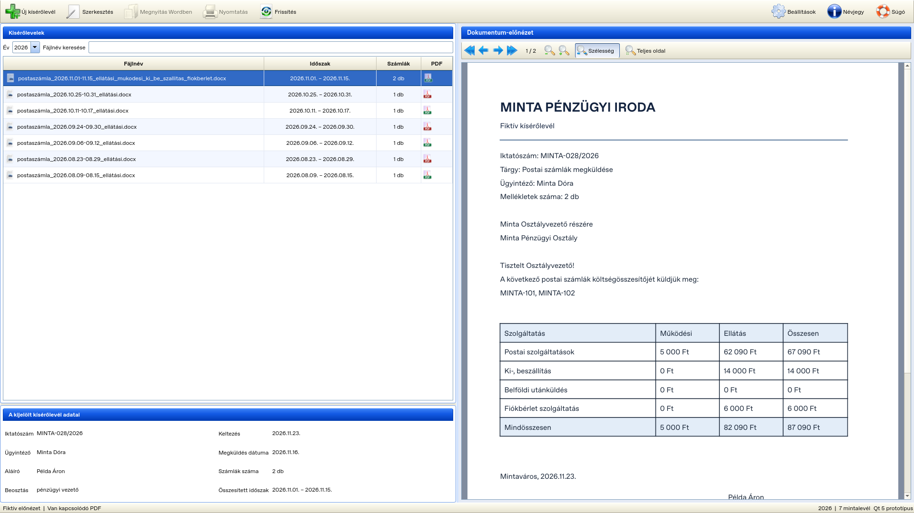
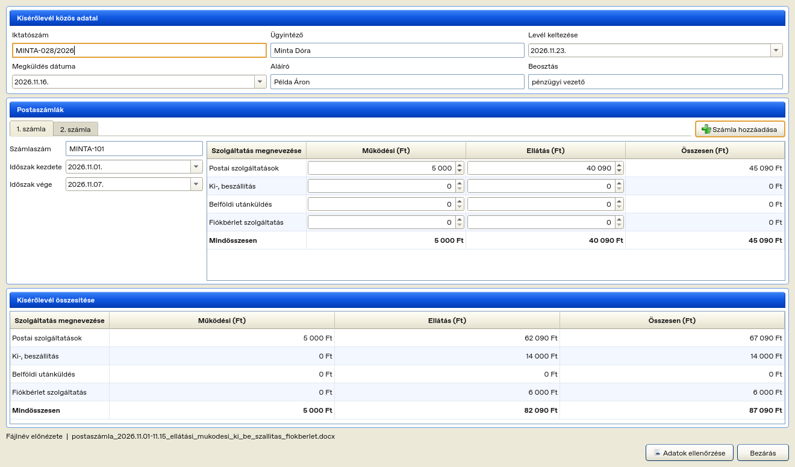

# Postaszámla – Qt 5 felületi prototípus

Az első migrációs szakasz a `prototype/qt5-luna` ágon fut. A kísérőlevéllista, az adatpanel, a PDF-előnézet és az Új kísérőlevél ablak fiktív adatokon működik. A párbeszédablakban hozzáadhatók és kiválaszthatók számlák, szerkeszthetők a költségek, valamint élőben látható az összesítés és a fájlnév. A számítást és a fájlnévképzést a meglévő Postaszámla-modulok végzik. Az „Adatok ellenőrzése” a memóriában ellenőrzi az űrlapot.

## Indítás

A Postaszámla repó gyökerében, Windows x64 alatt előre telepített **Python 3.10.11**-gyel:

```powershell
py -3.10 -m venv .venv-qt5
.venv-qt5\Scripts\python.exe --version
.venv-qt5\Scripts\python.exe -m pip install -r prototype/qt5/requirements.txt
.venv-qt5\Scripts\python.exe -m prototype.qt5
```

A prototípus külön virtuális környezetben a forrásból fut. A csomaglista az EDPD 2.6.3 verzióit rögzíti: PySide2 és shiboken2 5.15.2.1, PyMuPDF 1.23.26, valamint PyMuPDFb 1.23.22.

A valódi EDPD Luna felülettel való indításhoz kell az EDPD 2.6.3 meglévő helyi checkoutja. A címke commitja `543845a5e60eacc43253ea8e28fdd33e611ea4a6`. [EDPD v2.6.3 forrás](https://github.com/baloghim/beerkezett_posta_kezeles/tree/v2.6.3) · [EDPD licenctájékoztató](https://github.com/baloghim/beerkezett_posta_kezeles/blob/v2.6.3/LICENSE)

```powershell
.venv-qt5\Scripts\python.exe -m prototype.qt5 --edpd-source "C:\Munka\beerkezett_posta_kezeles"
```

Ebben a módban a prototípus az EDPD `ui/appearance.py` és `ui/themes/` moduljaival alkalmazza a Luna QSS-t és palettát mindkét ablakra. Az EDPD `ui/icons.py` kezeli a közös ikon-szerepeket, a `ui/proportional_table.py` a kísérőlevéllistát, a `ui/pdf_viewer.py` pedig a memóriában előállított fiktív PDF-et jeleníti meg. Az előnézet mentési és nyomtatási műveletei rejtve vannak. Az EDPD moduljai a megadott munkapéldányban maradnak.

A paraméter nélküli indítás saját Luna-jellegű Qt-stílust és saját PDF-nézetet használ. Mindkét módban a Postaszámla Crystal Remix grafikái adják a saját ikonokat. Az eredet és a licencek a [Postaszámla ikonforrásainál](../../postaszamla/icons/FORRAS.md) olvashatók. A Qt/PySide2 és a PyMuPDF terjesztési feltételeit az EDPD licenctájékoztató sorolja fel. A prototípus forrásból fut, a telepített Qt és MuPDF könyvtárakkal.

## Tényleges képernyőképek

A képek az EDPD 2.6.3 checkouttal futó PySide2-alkalmazás tényleges ablakairól készültek, Linux X11-en, 1920 × 1080-as virtuális kijelzőn, fiktív adatokkal. A főablak 1920 × 1080, a párbeszédablak 1320 × 775 pixel. A főablak paneljei 958 és 957 pixel szélesek, köztük 5 pixeles elválasztóval. Az ellenőrzés a főablak és a párbeszédablak közös alkalmazáspalettáját és az EDPD Luna QSS pontos betöltését is vizsgálja.





## Indulási mérés és tesztelés

Öt külön Python-folyamatot indítottunk. A Linux X11 virtuális kijelző és a betűtár gyorsítótára már futott. Az időt a modul belépési pontjától az első megjelenített ablakig, illetve az első mintadokumentum előnézetéig mértük az EDPD módban.

| Mérés | Medián | Tartomány |
| --- | ---: | ---: |
| Főablak megjelenése | 3,372 s | 3,330–3,386 s |
| Első PDF-előnézet | 3,484 s | 3,381–3,524 s |

Az első PDF megjelenítése a főablak után 51–152 ezredmásodpercet igényelt. A mérés a felületi inicializálást és egy kisméretű, fiktív PDF-et fed le. Ismétlés és képernyőkép-rögzítés:

```powershell
.venv-qt5\Scripts\python.exe -m prototype.qt5 --edpd-source "C:\Munka\beerkezett_posta_kezeles" --measure
.venv-qt5\Scripts\python.exe -m prototype.qt5 --edpd-source "C:\Munka\beerkezett_posta_kezeles" --screenshots "C:\Temp\postaszamla-qt5"
$env:POSTASZAMLA_EDPD_SOURCE = "C:\Munka\beerkezett_posta_kezeles"
.venv-qt5\Scripts\python.exe -m unittest discover -s prototype/qt5/tests -v
```

A branch Windows Server 2022 munkafolyamata a rögzített EDPD-forrással futtatja a Qt teszteket, elindítja az ablakot és rögzíti az indulási mérését. A Full HD geometriaellenőrzés 1920 × 1080-as vagy nagyobb rendelkezésre álló területen fut. A kisebb Windows runner-kijelzőn a tényleges ablak, a panelosztás és a vezérlők működését ellenőrizzük. A jelenlegi Postaszámla regressziós tesztjei a meglévő Python-környezettel futnak. A Windows 10 1607 x64 célgépes ellenőrzése külön lépés. A fiktív PDF-előnézet DOCX-konverzióhoz vagy Word-automatizáláshoz nem kapcsolódik.
